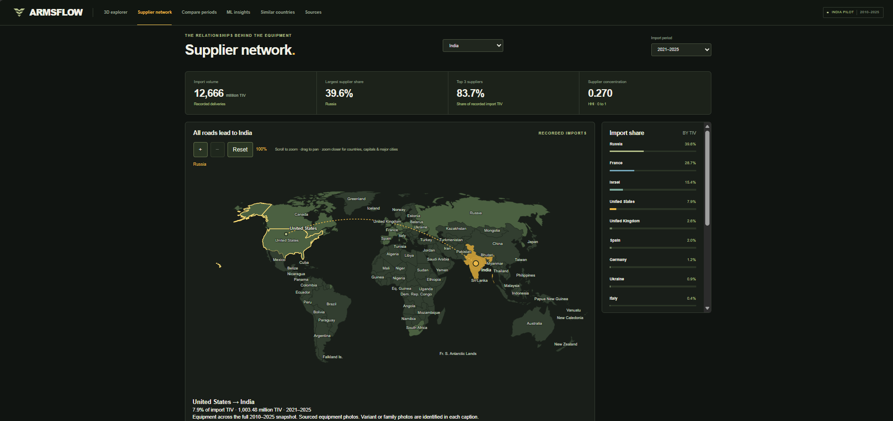
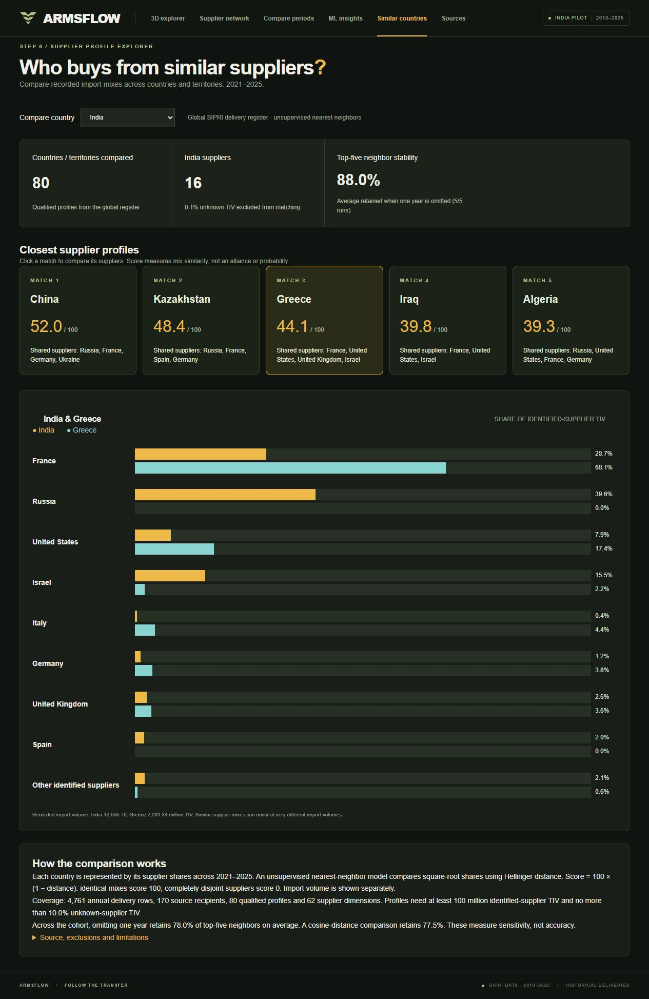

# ArmsFlow — weapons and supplier explorer

Steps 1–7 are implemented: equipment exploration, interactive supplier maps, unusual-change detection, similar-country profiles and local integration checks. Step 8 is complete: [open the live demo](https://armsflow-di1q.onrender.com). See [Step 7 validation](docs/step7_validation.md).

Run `start_armsflow.cmd` and open http://127.0.0.1:8000. See [website guide](docs/step4_website.md) for setup, features and validation limits.


**Live website:** [https://armsflow-di1q.onrender.com](https://armsflow-di1q.onrender.com)

Hosted on Render Free; the first visit after inactivity may take about a minute to wake.

## Public repository setup

This repository contains the application source, build scripts, documentation, attributed visual assets and screenshots. **Original source downloads, the full research database and local Python environment are not included.** A compact, read-only runtime snapshot is included under `deployment/` for the educational demo. Restore it with `python scripts/restore_runtime.py`. Full research reproduction still requires collecting the sources described below. See [Render deployment](docs/step8_deployment.md).

```powershell
python -m venv .venv
.venv\Scripts\python.exe -m pip install -r requirements-web.txt -r requirements-ml.txt
npm ci
npm run build
```

Collect the source snapshots using [source collection](docs/source_collection.md), [additional recipients](docs/multiple_recipients.md) and [global similarity collection](docs/step6_similarity.md). The manifests under `data/` record filenames, filters and hashes. Revisions to upstream exports must be reviewed; do not bypass the snapshot checks. Prepare the additional-recipient JSON with `python -m pipeline.prepare_recipients --retrieved-date YYYY-MM-DD`, using the actual download date.

Then build the database and derived analyses:

```powershell
.venv\Scripts\python.exe -m pipeline.build_database
.venv\Scripts\python.exe -m pipeline.build_metrics
.venv\Scripts\python.exe -m pipeline.ml_insights
.venv\Scripts\python.exe -m pipeline.similarity
.venv\Scripts\python.exe -m web
```

Open http://127.0.0.1:8000. The server runs locally; publishing this GitHub repository does not deploy the website. Photographs and maps retain their respective licenses; see [image credits](docs/equipment_images.md), [map source](docs/india_boundary.md) and frontend notices. No blanket license is granted over third-party content.





## Expanded country coverage

The supplier network and equipment library cover ten countries, with quick access to nine nuclear-armed states and Ukraine as an additional country. There are 833 recipient-specific equipment entries and military spending series for 2010–2025. Nuclear status is contextual: the transfers shown are major conventional weapons. [Sources, reproduction and limitations](docs/country_expansion.md).

## Original India pilot collection

The original files were downloaded on **6 November 2026** from SIPRI, India's Ministry of Defence/PIB and Dassault Aviation. All nine files are preserved without edits in `data/raw/`.

| Dataset | Actual coverage |
|---|---|
| Annual supplier TIV table | India, 2010–2025; 16 years; 22 supplier labels, including one unknown-supplier label |
| Annual equipment delivery register | 782 delivery rows across 233 deal IDs, 149 distinct designation labels and 9 equipment categories |
| Official period comparison | 2011–2015, 2016–2020 and 2021–2025 |
| Supporting documents | SIPRI's 2025 trends report, methods and terms; MoD's 2022 review; two Dassault announcements |

These are source records, not invented demo values. Distinct designation labels are not a cleaned count of unique weapon models. A delivery row is not one weapon: it can describe multiple units delivered under a deal during a year.

## Checks completed

- All three CSV exports parse correctly. The equipment register contains only India and delivery years within 2010–2025, with no exact duplicate rows or duplicate deal/year keys.
- The annual register TIV sums agree with nonblank supplier-table cells within 0.5 million TIV, consistent with the export's rounding conventions.
- SIPRI's official comparison export reproduces its published India supplier shares: Russia 70%, 51% and 40% across the three periods; France 29% and Israel 15% in 2021–2025. See the [SIPRI report](https://www.sipri.org/sites/default/files/2026-03/fs_2603_at_2025.pdf), pages 6 and 9. This is consistency checking against another SIPRI output, not independent corroboration.
- The Rafale register entries total 36 aircraft delivered during 2019–2022. The [Ministry of Defence's review](https://www.pib.gov.in/Pressreleasepage.Aspx?Lang=2&PRID=1884353&Reg=3) independently confirms completion of 36 deliveries by December 2022.
- SHA-256 hashes are recorded for all nine source files. The verification script checks them again without rewriting the raw data.

One Rafale order-year conflict and an unresolved production-field interpretation are recorded in [data quality notes](docs/data_quality_notes.md). They have not been silently corrected. The script's passing result means the stated checks passed, not that every field has been independently verified.

## Open these files

- [Source manifest](data/source_manifest.json): original URLs, export filters, retrieval date, units, sizes and hashes.
- [Collection instructions](docs/source_collection.md): how to reproduce the downloads.
- [Data dictionary](docs/data_dictionary.md): source fields and their meaning.
- Validation results (`docs/source_validation.json`, generated locally): machine-readable counts and checks.
- [Quality notes](docs/data_quality_notes.md): estimates, source conflicts and limits.
- [Database guide](docs/step2_database.md): Step 2 implementation, setup and SQL usage.
- [Database schema](sql/schema.sql) and [example SQL](sql/explore_data.sql).
- Step 2 validation (`docs/step2_validation.json`, generated locally): final build checks, row counts and fingerprints.
- [Step 3 analysis](docs/step3_analysis.md): findings, formulas, charts and reproduction steps.
- Step 3 validation (`docs/step3_validation.json`, generated locally): metric checks and proof that source-table fingerprints are unchanged.
- [Metric SQL](sql/metrics.sql) and [analysis queries](sql/analysis_queries.sql).
- [Project status](project_status.json): the eight steps and the approval gate.

To rerun the read-only checks from this folder:

```powershell
python scripts/verify_source_snapshot.py
```

Python 3.10+ is sufficient; this script needs no third-party packages. It prints results to the terminal and exits with an error if structural checks or hashes fail.

## Scope and next step

This pilot supports India's historical supplier charts and sourced equipment pages. It does **not** provide current operational inventories, every weapon ever acquired, pending orders outside these delivery filters, or a global ML training panel. TIV measures transfer volume, not money or a count of weapons. Four original illustrative 3D exterior models are included.

Step 2 loaded the records into SQL with source references, estimate flags, missing-value statuses and reviewed identity mappings. Step 3 adds supplier shares, top-three concentration, HHI, percentage-point changes and supplier-mix distance. All 18 automated tests, 14 base-build checks and 12 metric checks pass. The documented field conflicts remain open; cleaning does not turn uncertain source claims into confirmed facts.

The local website and 3D equipment viewer are implemented. Step 5 now includes experimental ML insights for India, Russia and the US. See [Step 5 model and validation](docs/step5_ml.md) for reproduction, temporal evaluation and limitations. Step 6 now compares 80 qualified country/territory supplier profiles using a newly collected global 2021–2025 SIPRI register and unsupervised nearest neighbors. See [Step 6 methodology and validation](docs/step6_similarity.md). Step 7 local integration and responsive-browser checks are complete; see [validation and limitations](docs/step7_validation.md). Step 8 is deployed on [Render Free](https://armsflow-di1q.onrender.com).

The downloaded source files retain their publishers' rights. Raw snapshots are excluded by `.gitignore`; raw data files are not included in this public repository. Review the [SIPRI reuse terms](https://www.sipri.org/about/terms-and-conditions) before including data in a public deployment.
