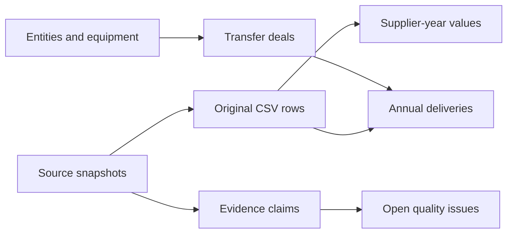

# Step 2 — cleaned data and SQL database

**Completed for the India pilot, 2010–2025.** The database is `data/processed/armsflow.duckdb`. This document describes the base database; the subsequent [Step 3 analysis](step3_analysis.md) adds derived metric views.

The Python pipeline reads the three original SIPRI exports, validates all nine source-file hashes, preserves the original cells, and writes typed relational tables. It uses DuckDB 2.0.0, pinned in `requirements.txt`; no server is required. The project has its own `.venv` and does not change your global Python packages.

## What cleaning means here

- Trim surrounding whitespace for typed values and matching labels. Keep every original CSV cell in `raw_row`, including spaces, repeated headers and empty strings.
- Parse TIV and quantities into exact `DECIMAL(18,6)` columns. Reject invalid, negative, non-finite or over-precision numbers rather than coercing them.
- Keep **167 blank supplier-year cells as SQL NULL** with `no_identified_deliveries` status. They are not imputed as measured zeros.
- Recognize **11 rounded-zero cells** whose original strings are `0 `, including a trailing space. Store their numeric value as zero with separate `rounded_zero` status. There are 174 remaining positive supplier-year cells.
- Parse `Yes`/`No` flags into true/false; leave unspecified flags NULL. The 32 unspecified quantity flags remain distinct from explicit `No`.
- Use reviewed, one-to-one entity identifiers. Keep the unknown-supplier label. No historical entity remapping, fuzzy matching or automatic merging of equipment variants is performed.
- Give each distinct designation/description/category combination a deterministic equipment identifier. All 149 combinations remain separate.
- Keep the three repeated `Percentage` headers in the comparison export associated with their respective periods. Store published percentages as source references; no new supplier metrics are calculated in this step.
- Keep totals in separate tables so a source total cannot become a supplier or be counted twice.
- Stop on duplicate delivery keys, unexpected columns, changed source hashes, unreviewed entities or inconsistent deal identities.

The Step 1 zero-count diagnostic originally missed the trailing spaces and reported zero rounded-zero cells. That diagnostic and its generated report have now been corrected; the original downloads are unchanged.

## Tables and access views

| Table | Rows | Purpose |
|---|---:|---|
| `source_snapshot` | 9 | Publisher, URL, query manifest, hashes and CSV headers |
| `raw_row` | 828 | Every original data row from the three CSVs, with physical source line |
| `entity` | 23 | India, 21 named suppliers and an unknown-supplier category |
| `equipment` | 149 | Distinct source equipment identities |
| `transfer_deal` | 233 | Deal ID and its supplier, recipient and equipment |
| `delivery` | 782 | Annual quantities, flags, order years, condition and TIV |
| `bilateral_annual` | 352 | 22 supplier labels × 16 years, including explicit blank-cell records |
| `recipient_annual` | 16 | Published India annual totals |
| `supplier_period` | 88 | Published supplier values/shares for four periods across the two exports |
| `recipient_period` | 4 | Published period totals |
| `evidence_claim` | 3 | Separately sourced Rafale claims and their evidence locations |
| `quality_issue` | 3 | Open field conflicts or definition questions |
| `build_metadata` | 1 | Input/code fingerprints, logical data hash and build version/time |

`delivery_detail` joins equipment names, supplier/recipient labels, source URLs and review status. `bilateral_annual_detail` adds country labels and sources to annual values. Both are views over stored records, not ML or supplier-metric outputs.



## Rebuild and inspect

Open PowerShell in the project folder. The environment is already installed on this computer:

```powershell
.\.venv\Scripts\python.exe -m pipeline.build_database
.\.venv\Scripts\python.exe scripts/inspect_database.py --equipment Rafale
.\.venv\Scripts\python.exe -m unittest discover -s tests -v
```

On another machine, first restore the source downloads using `docs/source_collection.md`, then install Python **3.11 or newer** and run:

```powershell
python -m venv .venv
.\.venv\Scripts\python.exe -m pip install -r requirements.txt
```

Linux/macOS use `.venv/bin/python` instead. See [DuckDB's Python documentation](https://duckdb.org/docs/2.0/clients/python/overview) for its installation and connection API.

Open the database through Python or a DuckDB-compatible SQL client. Example from Python:

```python
import duckdb

with duckdb.connect("data/processed/armsflow.duckdb", read_only=True) as con:
    rows = con.execute("""
        SELECT designation, supplier, delivery_year,
               quantity_delivered, quantity_estimated, source_url
        FROM delivery_detail
        WHERE designation = ?
        ORDER BY delivery_year
    """, ["Rafale"]).fetchall()
    print(rows)
```

More examples are in `sql/explore_data.sql`; the complete table definition is in `sql/schema.sql`. Queries should use parameters for user-entered filters. Numerical values are [fixed-precision decimals](https://duckdb.org/docs/2.0/sql/data_types/numeric); they are not financial amounts.

## Verification completed

The final build passes **14 data checks**. They include source joins, complete supplier/year coverage, preservation of unknown suppliers, annual register reconciliation to supplier cells and recipient totals, the published period-reference values and the Rafale programme total.

**Eight automated tests pass**, covering parsing, quoted/multiline CSV cells, repeated headers, estimate flags, source hash failures, duplicate delivery rejection, failed-load preservation and repeatable rebuilds. Two builds of the same snapshot have the same logical table hashes and row counts. Physical database-file bytes can differ because build time and database storage metadata differ.

The builder creates a new temporary database, loads it in a transaction, runs checks, closes it, then replaces the prior generated database. A failed load leaves the previous database untouched; this behavior was tested both before loading and on a database constraint failure. Keep SQL clients closed while rebuilding on Windows.

The pipeline never edits the raw source files. Generated databases and raw downloads are excluded from Git because both contain third-party source data. Code, schema, reviewed mappings and documentation can be tracked separately.

## Remaining review items and scope

The Rafale export's 2017 order year is preserved alongside the manufacturer claim dated 23 September 2016. Its local-production flag remains a source claim, not an assembly-country conclusion. The undefined `SIPRI estimate` field is retained as text and excluded from calculations. These three issues remain open in SQL.

This database contains historical transfers to India, not current operational inventory. Source-provided estimates are still estimates after cleaning. Data for other recipients and earlier years must be collected and validated before the multi-country ML steps; this loader intentionally rejects scope changes until reviewed.

Step 3 subsequently added supplier shares, concentration and historical supplier changes; see `step3_analysis.md`. No website, 3D assets, ML models or deployment were created during Step 2.
