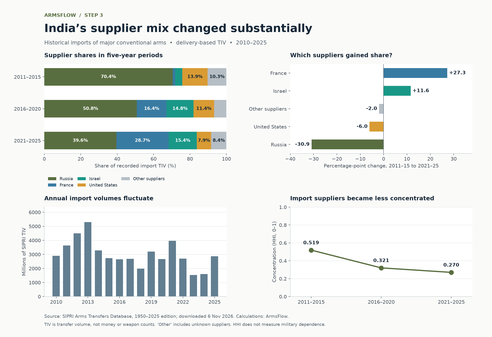

# Step 3 — India's suppliers and historical changes

**Calculated from the validated India database, 2010–2025. Step 4 has not started.**



## Results

Shares below use delivered TIV, aggregated across each five-year period. They are calculated values rounded for display; they are not copied from the published percentages. Changes are calculated before rounding, so displayed differences may not subtract exactly.

| Supplier | 2011–2015 | 2016–2020 | 2021–2025 | Change, first to last |
|---|---:|---:|---:|---:|
| Russia | 70.4% | 50.8% | 39.6% | -30.9 pp |
| France | 1.5% | 16.4% | 28.7% | +27.3 pp |
| Israel | 3.8% | 14.8% | 15.4% | +11.6 pp |
| United States | 13.9% | 11.4% | 7.9% | -6.0 pp |

The rounded published Russia shares of 70%, 51% and 40% are reproduced at SIPRI's display precision. See the [SIPRI fact sheet](https://www.sipri.org/sites/default/files/2026-03/fs_2603_at_2025.pdf), pages 6 and 9.

| Metric | 2011–2015 | 2016–2020 | 2021–2025 |
|---|---:|---:|---:|
| Total import volume (million TIV) | 19,449.50 | 13,187.51 | 12,665.76 |
| Top-three share (%) | 88.2 | 81.9 | 83.7 |
| Concentration (HHI) | 0.519 | 0.321 | 0.270 |
| Unknown-supplier share (%) | 0.000 | 0.000 | 0.083 |

The supplier-mix distance between 2011–2015 and 2021–2025 is **0.419** on a 0–1 scale. Between 2016–2020 and 2021–2025 it is **0.180**. Recorded import volume changed by **-3.96%** between those two most recent periods.

These describe historical changes in recorded import volume and supplier composition. They do not establish political causes, current weapon stocks or total military dependence.

## Method

Let V(s,P) be supplier s's delivered TIV in period P, and T(P) the sum over all suppliers.

| Measure | Definition |
|---|---|
| Supplier share | V(s,P) / T(P), defined only for positive complete totals |
| Top-three share | Sum of the three largest shares; stable supplier-ID order resolves boundary ties |
| Concentration | HHI = sum of squared fractional shares; range 0–1 |
| Share change | 100 × (later share − earlier share), in percentage points |
| Supplier-mix distance | Half the sum of absolute supplier-share differences, with aligned supplier identities |
| Volume change | 100 × (later total / earlier total − 1), defined only with positive earlier total |

Period shares are computed after summing TIV, never by averaging annual percentages. All tied top suppliers are reported. Comparison periods must have equal length, be non-overlapping and run chronologically.

## Coverage and uncertainty

- The delivery register supplies more precise TIV than the rounded annual table. Its totals reconcile with the source tables within 0.5 million TIV.
- The 167 explicitly blank supplier-year cells contribute zero **identified** volume in the derived calculation only when there are no corresponding register deliveries. Original SQL NULLs and source statuses remain unchanged.
- Eleven rounded-zero source cells have positive underlying register TIV; these small flows remain in the calculations.
- Missing coverage rows, missing register TIV or unreconciled positive cells yield incomplete periods. Shares, HHI and supplier-mix distance become unavailable rather than using a partial denominator.
- A complete zero-total period is labelled no recorded deliveries; shares and concentration are undefined. Unknown-supplier volume remains included and separately reported.
- Three source-field review issues remain open. No new certainty is assigned to estimated deliveries, and no order-year or local-production conflict is silently overwritten.
- This pilot covers India only. No global comparison, ML prediction or causal geopolitical conclusion has been produced.

## Outputs and reproduction

- [Executed notebook](../notebooks/02_supplier_patterns.ipynb)
- [Annual supplier-share chart](../reports/india_annual_supplier_shares.png)
- [Vector overview chart](../reports/india_supplier_analysis.svg)
- [Machine-readable results](../reports/analysis_results.json)
- [SQL metric definitions](../sql/metrics.sql) and [example queries](../sql/analysis_queries.sql)
- [Validation report](step3_validation.json)

From the project folder, install `requirements-analysis.txt` into `.venv` if necessary, then run:

```powershell
.\.venv\Scripts\python.exe -m pipeline.analyze --notebook
.\.venv\Scripts\python.exe -m unittest discover -s tests -v
```

The analysis command verifies the original snapshot and base SQL tables, installs/rebuilds metric views atomically, and writes the report, charts and JSON. `--notebook` also executes all notebook cells. If rebuilding the Step 2 database, run the analysis command again afterwards to restore its derived views.

The analysis produces 29 periods (16 annual, 12 five-year windows and the full span), 638 supplier-period records, and 18 comparisons. Twelve metric checks reconcile sources and validate bounds. Ten hand-case/integration tests cover weighted periods, ties, new suppliers, unknown suppliers, zero totals, missing coverage and repeatability; the eight ingestion tests remain part of the full suite.

## Next approval

Step 4 will build the website and 3D equipment viewer after your approval. These are analysis artifacts, not the website interface.
